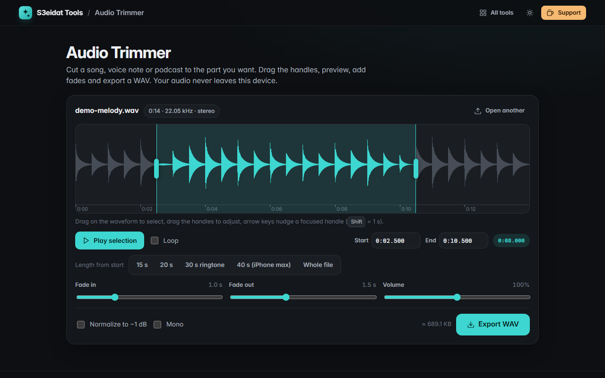

# Audio Trimmer

> Cut and trim audio files, add fades and export WAV. Free, private, and it runs entirely in your browser.

### ▶ [Open Audio Trimmer](https://s3eidat.github.io/audio-trimmer/)



## Features

- Open or drop **MP3, WAV, M4A/AAC, OGG, Opus, FLAC**: anything your browser can decode
- **Waveform** with a time ruler; drag to select, drag the **start/end handles**, or type exact times (`1:05.250`)
- Arrow keys nudge a focused handle by 10 ms (<kbd>Shift</kbd> = 1 s)
- **Play the selection** (<kbd>Space</kbd>), click inside it to listen from that point, **loop** it
- **Fade in / fade out**, **volume** up to 200 %, **normalize** to −1 dB, **mono** downmix
- The waveform shows the result of your fades and volume before you export
- **Length presets**: 15 s, 20 s, 30 s ringtone, 40 s (the iPhone ringtone maximum), whole file
- **Export WAV** (16-bit PCM, encoded in the page) with a size estimate

## Privacy

Your audio never leaves your device. There is no server, no account, no analytics. The page ships with a
strict Content-Security-Policy (`connect-src 'self'`), so the browser itself blocks any attempt to send data anywhere.

## Run it yourself

It's plain HTML, CSS and JavaScript with no build step:

```bash
git clone https://github.com/s3eidat/audio-trimmer
cd audio-trimmer
python -m http.server 8000
```

Then open http://localhost:8000.

## Support

If this saved you time, **[buy me a coffee ☕](https://s3eidat.github.io/coffee/)**. It keeps every tool free.

---

Part of **[S3eidat Tools](https://s3eidat.github.io/)**: 100+ free, private tools that run in your browser. MIT licensed.
